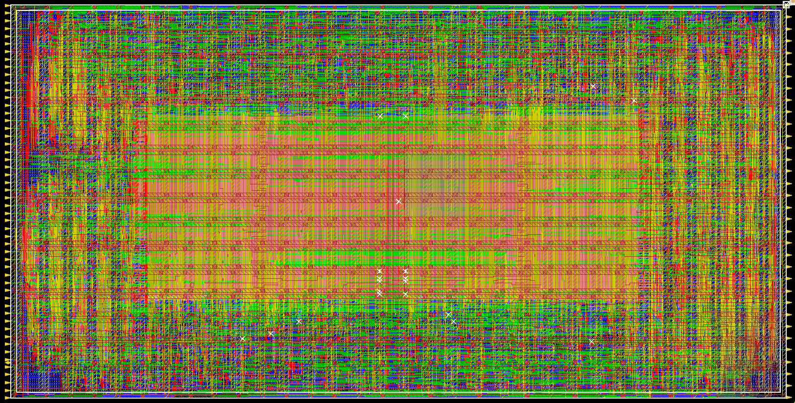
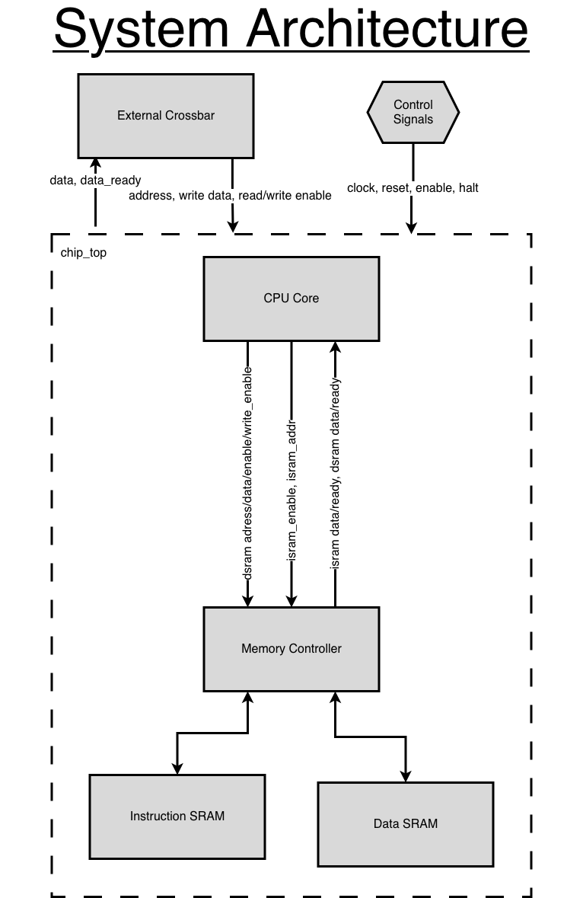
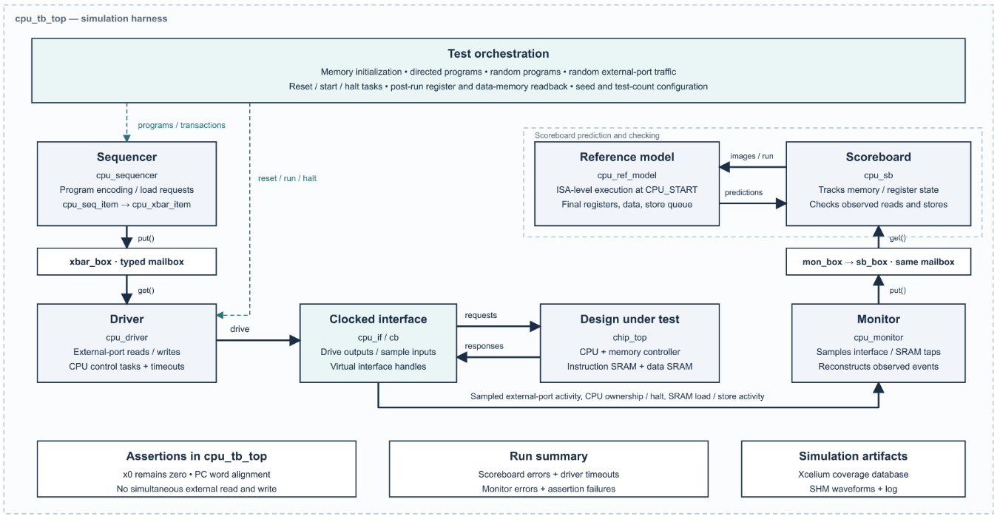
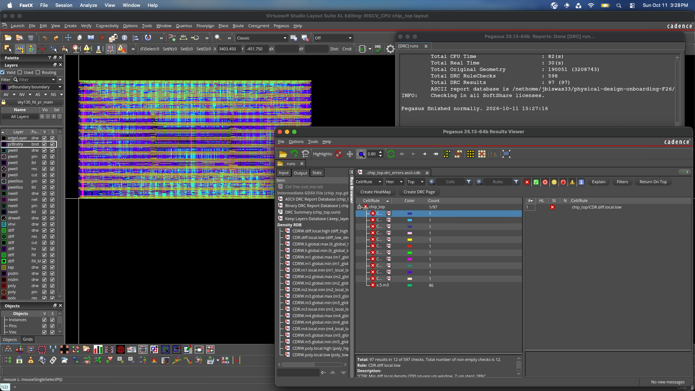
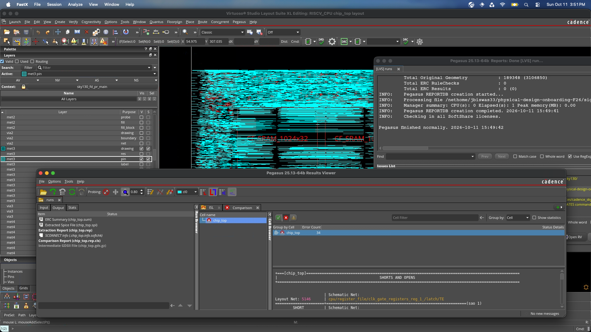

# RISC-V-Core
32-bit RISC-V core implementing an RV32I instruction subset, with SystemVerilog RTL, directed and constrained-random verification, and a SKY130 synthesis and physical design flow.

## Overview
### About the Project
This repository contains the files for a 32-bit CPU core I designed based on a subset of the RISC-V ISA. I have worked through the full RTL-to-GDS flow, from digital design to design verification to physical design. The final chip core has an area of about 800,000 microns squared, with a 2:1 aspect ratio (1,271.95 microns x 635.975 microns). The chip features two 1024x32 SRAM macros (ISRAM and DSRAM), and 6,798 standard cells.



### Why I Built This
This project was made as part of the onboarding process for the Georgia Tech SiliconJackets club. Additionally, this project taught me the fundamental skills needed to enter the world of VLSI design: digital design, design verification, and physical design. This is a field that I have grown increasingly interested in recently, and I hope to create more complex designs in the future.

### Attributions
As this project was done as part of the SiliconJackets onboarding process, some of the files in this repo were provided by them. These include
- SRAM Macro/Memory Controler
- Some verification skeleton code
- Certain physical design config files
- Makefiles
- Register File

## Project Status
This project is still actively being improved. I am currently working on adding instruction pipelining to increase the clock frequency.

## Repository Structure
| Folder | Details |
| ------ | ------- |
| RTL | Contains the RTL for the CPU, memory controller, and chip_top. Does not contain the SRAM macro due to licensing restrictions. Written in SystemVerilog |
| Verification | Contains an initial and final testplan outlining the full verification process of this design. Also includes a testbench with a driver, monitor, scoreboard, sequencer, and reference model. |
| Physical Design | Contains configuration and flow scripts for synthesis and place/route. THe outputs of synthesis and place/route have not been included to avoid publishing licensed content. |
| Docs | Contains supplementary materials such as images of the chip and its architecture |

## CPU Architecture



## Supported Instructions
The following Subset of the RISC-V ISA has been implemented

- `addi`: addition with a signed immediate
- `add`: register-register add
- `sub`: register-register subtract
- `lw`: load word from data SRAM using an immediate offset
- `sw`: store word to data SRAM using an immediate offset
- `beq` against x0: branch if zero
- `sll`: left logical shift
- `srl`: right logical shift
- `ebreak`: halt the CPU

## Verification


## Physical Design — Technology/library versions, synthesis, floorplanning, placement, CTS, routing, and DRC/LVS methodology.
The physical design uses the SJapr environment provided by SiliconJackets. The flow utilizes Synopsys Design Compiler and Cadence Innovus.

## Results
The following results describe the current physical implementation. Functional verification is ongoing.

| Metric | Result |
|---|---|
| Core dimensions | 1,271.95 × 635.975 µm |
| Core area | 808,928 µm² (0.809 mm²) |
| Aspect ratio | 2:1 |
| SRAM capacity | Two 1024 × 32-bit macros: 4 KiB instruction memory and 4 KiB data memory |
| Standard-cell count | 6,798 |
| Core utilization | 46.925087 |
| Target clock period | 5 ns |
| Post-route setup WNS / TNS | -1946.496627 ns |

### Verification Results
Directed and constrained-random tests check instruction execution, register state, memory accesses, and interface behavior against a reference model.

### DRC/LVS Results
Both DRC and LVS both currently have numerous errors. I am currently in the process of fixing these errors



### Layout


## Requirements and External Dependencies

The verification and physical design flows require a Linux environment with licensed EDA tools. These tools and third-party technology files are not distributed with this repository.

### Required Tools

| Tool | Purpose |
|---|---|
| GNU Make | Runs the repository’s build targets |
| Python 3 | Generates simulation source links and synthesis file lists |
| Cadence Xcelium | Compiles and runs the SystemVerilog testbench |
| Cadence SimVision | Displays simulation waveforms |
| Cadence IMC | Analyzes simulation coverage |
| Synopsys Design Compiler | Synthesizes the RTL |
| Cadence Innovus | Performs physical implementation |
| Cadence Virtuoso and Pegasus | Support layout inspection and DRC/LVS checks |
| `tcsh` | Runs the physical design environment and launcher scripts |

Verification has been run using **Xcelium 25.03-s003**. Other tool versions have not been confirmed.

Valid licenses and access to the relevant license servers are required. The physical design environment setup contains Georgia Tech-specific paths that must be adapted for other installations.

### SRAM Dependencies

The design uses two `CF_SRAM_1024x32` SRAM instances. Authorized users must obtain the required models and physical views separately.

Place the simulation model at:

```text
RTL/src/CF_SRAM_1024x32.tt_180V_25C.v
```

Place the SRAM physical-design package under:

```text
Physical Design/inputs/CF_SRAM_1024x32/
├── lib/    # Liberty timing models
├── db/     # Compiled timing library
├── lef/    # Physical abstract
└── gds/    # Macro layout
```

LVS additionally requires:

```text
Physical Design/signoff/CF_SRAM_1024x32.cdl
```

Simulation selects the `CF_SRAM_1024x32_macro` model through the `SIM` define. Synthesis uses the `CF_SRAM_1024x32` library cell.

### SKY130 Technology Dependencies

The current scripts expect the following directory structure:

```text
Physical Design/resources/
├── cadence_sky130/
│   ├── sky130_release_0.1.0/
│   └── sky130_scl_9T_0.1.2/
└── synopsys_libs/
```

These directories provide standard-cell timing libraries, physical abstracts, extraction technology, and physical-verification rules. The `synopsys_libs/` directory contains the compiled libraries referenced by the synthesis scripts.

Obtain the exact compatible packages through an authorized provider or institutional installation. A generic SKY130 installation may not match the filenames, cells, or formats expected by this flow.

### Dependency Licensing

External models, libraries, and technology files remain subject to their respective licenses. They are excluded through `.gitignore` and must be installed locally before running the corresponding flows.

## Running the Project

Install the external dependencies described above before running the flows. Execute the following commands on a Linux machine with access to the required EDA tools and licenses.

### Clone the Repository

```sh
git clone https://github.com/JoelBiswas/RISC-V-Core.git
cd RISC-V-Core
```

### Configure the Simulation Environment

On the Georgia Tech server, enter `tcsh` and load Cadence:

```sh
tcsh
source /tools/software/cadence/setup.csh
which xrun
xrun -version
```

Other installations should use their own tool setup scripts.

### Run Verification

From the repository root, run a short simulation:

```sh
make xrun SEED=1 SIM_PLUSARGS="+NUM_RANDOM_PROGRAMS=2 +NUM_RANDOM_XBAR=5"
```

Run the default test suite:

```sh
make xrun SEED=1
```

The default configuration runs the directed tests, 100 random CPU programs, and 30 random external-port transactions. Change `SEED` to exercise another randomized stimulus sequence.

Inspect the simulation log:

```sh
less Verification/sim/behav/WORKSPACE/simulation.log
```

Review the reported errors and completion status; successful compilation alone does not indicate that verification passed.

### View Waveforms

From a graphical session, such as FastX:

```sh
make simvision
```

Waveforms are generated under:

```text
Verification/sim/behav/WORKSPACE/waves.shm/
```

### View Coverage

After running verification:

```sh
make coverage
```

This opens the coverage database in Cadence IMC and applies the exclusions in `Verification/sim/behav/exclusions.vRefine`.

### Run Physical Design

From the repository root:

```sh
cd "Physical Design"
chmod +x scripts/SJapr scripts/helpers/rename_rundir.tcsh
source envsetup
```

The physical design launcher provides these commands:

```sh
SJapr syn     # Synthesis
SJapr apr     # Place and route using existing synthesis outputs
SJapr flow    # Synthesis followed by place and route
```

For interactive execution:

```sh
SJapr syn -i
SJapr apr -i
```

Outputs are generated under `Physical Design/outputs/synthesis/` and `Physical Design/outputs/apr/`.

**Current limitation:** the physical design launcher contains unquoted paths. These must be corrected to support the space in the `Physical Design` directory name before this flow can be treated as reproducible from a fresh clone.

### Clean Simulation Outputs

From the repository root:

```sh
make clean
```

This removes the generated verification workspace, including logs, waveforms, and coverage data. Save any results you want to retain before cleaning.

## Known Limitations and Future Work

### Current Limitations

- **Partial RV32I support:** The core implements `addi`, `add`, `sub`, `lw`, `sw`, `beq`, `sll`, `srl`, and `ebreak`. It does not implement the complete RV32I instruction set.
- **Limited memory:** Instruction and data memories each contain 1024 32-bit words (4 KiB). Memory addresses are reduced to 10-bit word indices; out-of-range accesses are not trapped.
- **Simplified halt behavior:** `ebreak` halts the core rather than entering an architectural exception handler.
- **No instruction pipeline:** The current implementation does not use a staged instruction pipeline.
- **Environment dependencies:** Simulation and physical design require licensed tools and separately obtained SRAM and technology files. Physical design scripts also require path-portability cleanup.

### Future Work

- Add directed regression tests for consecutive loads and stores.
- Introduce instruction pipelining with appropriate data-hazard and branch handling.
- Expand directed and constrained-random testing and document coverage across multiple seeds.
- Extend instruction support toward a more complete RV32I implementation.
- Improve flow portability and automate dependency checks.
- Document reproducible timing, area, and DRC/LVS results for each implementation revision.

## Licensing

This repository combines my original contributions with RTL scaffolding, verification components, and physical design flow files provided through Georgia Tech SiliconJackets.

No repository-wide license is currently granted. Third-party files remain subject to their respective licenses and permissions. Existing copyright and attribution notices are retained.

SRAM models, technology libraries, and other excluded dependencies must be obtained separately through authorized sources. Their exclusion from this repository does not change their licensing terms.